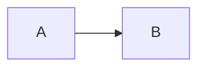
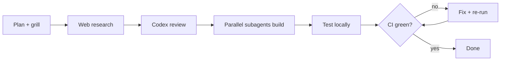

# AI-Assisted Development: Shipping a Diagram Renderer with Agents

I wanted this blog to render diagrams: mermaid, plantuml, and inline svg. Crucially, this had to happen without shipping diagram libraries to the browser. This case study explores how the feature was built using AI-assisted development. We look at where agents changed the outcome, and where they quietly failed until verified.

The goal was concrete. A reader loads a post and sees a rendered diagram, while the page ships zero runtime rendering code. Therefore, every diagram converts to static svg at build time.

## The task

The blog is a small Vite and React app. Posts are markdown files, inlined into the JavaScript bundle at build time through Vite's `import.meta.glob`. I wanted authors to write diagrams as fenced code blocks, like this:

````markdown

````

When the app builds, those blocks should become inline svg. Consequently, the browser never loads mermaid or plantuml. The feature required four core components:
1. A custom Vite plugin to execute conversions.
2. A sanitize schema to ensure inline svg is safe.
3. The converters themselves (mermaid via headless chromium, plantuml via java).
4. CI pipelines to run the pipeline on every push.

## The agentic loop

I did not write this feature alone in a text editor. Instead, it emerged from an agentic loop:



Each stage leveraged a specialized tool. Planning started in plan mode, where I was grilled on design choices. We pinned down key decisions: build-time versus runtime, plugin versus remark transformer, and svg delivery. This grill forced commitments before any code was written.

Next came web research. Three parallel searches confirmed the right package for each diagram type. They also surfaced draw.io conversion options. Through this, I learned that plantuml ships as a jar, while mermaid's path is a chromium CLI. Meanwhile, a niche package called `drawio2svg` claimed to convert draw.io xml in pure node.

Then Codex reviewed the plan. This was the step I had initially underestimated.

## Where the tools changed the outcome

Codex caught three things I would have shipped wrong.

First, it flagged the sanitize schema. I had written svg attribute names in their html spellings: `stroke-width`, `xlink:href`. However, Codex pointed out that `rehype-sanitize` matches hast property names in camelCase (`strokeWidth`, `xLinkHref`). The html spellings would have been silently dropped, breaking mermaid links. This was fixed before running any code.

Second, Codex caught the plantuml invocation. My plan used shell-style stdin redirection (`java -jar plantuml.jar -tsvg -pipe < tmp`). But node's `spawn` does not interpret shell redirection, so stdin must be piped programmatically. That avoided a bug that would have surfaced only at runtime.

Third, Codex flagged the draw.io converter as a mini markdown pipeline. It warned me to track referenced files as dependencies and include converter versions in the cache key.

Next, parallel subagents handled the wiring. We launched four single-file edits concurrently: the glob query change, the renderer's rehype plugins, the Vite config registration, and the CI java step. There were no conflicts because each agent touched an independent file. That is the sweet spot for parallel agents: well-scoped edits with zero shared files.

Then CI caught what everyone missed.

## What CI caught

The local build passed, and diagrams rendered locally. So I pushed the branch to trigger a workflow run. The build returned green, but the log told a different story. In reality, mermaid had failed:

```
mmdc exit 1: Failed to launch the browser process
No usable sandbox! ... unprivileged user namespaces with AppArmor
```

Chromium on the Ubuntu runner requires `--no-sandbox`. Because local builds ran on macOS, this never showed up locally. Worse, the plugin caught the error and continued. The build exited zero while the diagram silently remained raw markdown. It was a green check on a broken feature.

Two fixes resolved the problem. First, I added a puppeteer config with `--no-sandbox`, `--disable-setuid-sandbox`, and `--disable-dev-shm-usage`. Second, I configured the plugin to fail loud: a failed diagram conversion now aborts the build. The next CI run completed cleanly in nine seconds.

The lesson is blunt. Silent success is the most dangerous failure mode in AI-assisted development. An agent often wraps risky operations in try/catch blocks so tasks finish. But a passing build is not a working feature. You must verify actual output rather than exit codes.

## Lessons

A few key principles held up across the feature:

1. **Scope reviewers narrowly.** My first Codex review ran against the entire monorepo with multiple large submodules. It stalled for ten minutes until killed. Running Codex strictly inside the `./blog` directory finished in seconds.
2. **Use parallel subagents for independent edits.** The wiring edits were ideal for parallel subagents. However, core plugin logic was tightly coupled work suited for the main agent thread.
3. **Fan out research, plan centrally, build sequentially.** Broad parallel exploration worked best up front, followed by a single reviewed plan and disciplined implementation.

## What I would do differently

I trusted the draw.io package too long. Web searches described it as a pure typescript library with zero browser dependencies. In practice, it shipped uncompiled TypeScript with unresolved native dependencies (`gui` and `coroutine`). In the future, I will run a 30-second install-and-import smoke test before designing around a niche package.

I also declared victory too early at the local build stage. The true finish line was a clean CI run without log errors. Local success is necessary, but not sufficient.

## FAQ

### Did the agents write all the code?
No. The agents drafted, reviewed, and wired. The core judgment calls (build-time over runtime, failing loud, dropping broken dependencies) were mine. AI-assisted development still requires human direction.

### Is mermaid in the final bundle?
No. Mermaid, plantuml, and their tools are build-time dev dependencies. The shipped bundle contains only static svg strings.

### Was this faster than doing it solo?
Yes, but not because agents were flawless. They provided speed in breadth (parallel research, concurrent edits) and caught subtle bugs (hast property casing). However, they could not verify completion on their own. The speedup came from pairing their breadth with human verification.

---

*This post is part of the [Applicaudia blog](https://applicaudia.se/blog/). For more articles on app development and engineering, visit [applicaudia.se](https://applicaudia.se). The diagram renderer described here runs this very page.*
