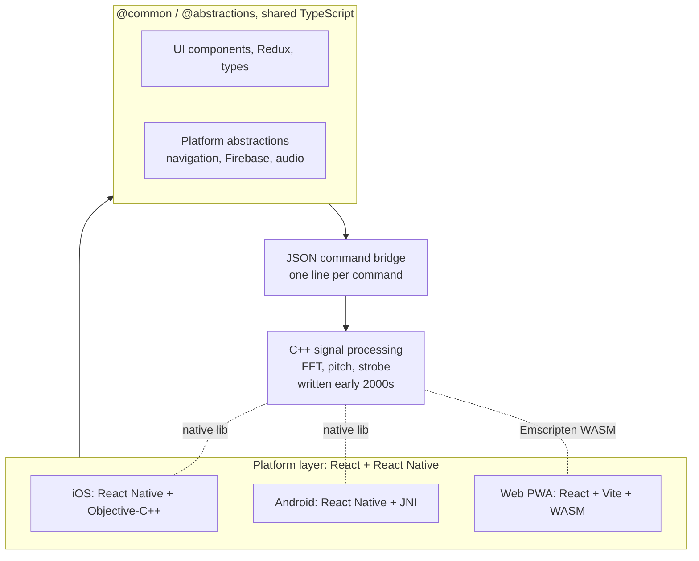

# Cross-Platform C++ React Native Integration for Solo Developers

Building native apps for iOS, Android, and web as a solo developer sounds difficult, especially as a solo developer. I've managed to ship multiple apps that run on iOS, Android, and Web while maintaining a single codebase that one person can handle.

The secret is balancing native performance and developer productivity by sharing code intelligently across platforms, putting performance-critical logic in C++, and using a JSON command bridge (described below) that allows for adding new performance critical features with only a few lines of code.

## The Architecture Pattern

The architecture has three layers.

- Top: platform-specific TypeScript handle UI and platform integration.
- Middle, a JSON command bridge forwards actions to native code - with 1:1 mapping to the top.
- Bottom, a C++ processing layer handles DSP and other heavyweight, performance intensive stuff.

This bottom layer compiles to native code for iOS and Android, and to WebAssembly for the web. The same algorithms written over my relatively long career, and I decided a few years ago to leverage them into an app called StroboPro, and other commercial apps that I cannot talk about.



### Platform Layer: React + React Native Web

Each platform has its own entry point. iOS and Android use React Native. The web uses React with Vite. Despite the different frameworks, all three can share React components through the react-native-web package.

Some code is truly universal. Types, utility functions, Redux state management, and business logic live in `@common/` and get used by all platforms. Platform-specific code, such as navigation abstractions or Firebase initialization, lives in `@abstractions/` with separate implementations for web, iOS, and Android.

DRY - code written in `@common/` and works on the PWA, mobile apps, Chromecast receiver, and Firebase Functions without changes.

### JSON Command Bridge: Easy to add features

The bridge between Typescript and C++ uses JSON commands. On the JavaScript side, you define a command structure with parameters. On the C++ side, a command handler processes it.

Adding a new command takes three steps. Define the structure. Implement the handler. Register it in the command table. That is it.

```cpp
static bool onCmdMyNewFeature(CmdHandlerNodeData* const pCmdData) {
  const json& jIn = pCmdData->jsonIn;
  CmdMyNewFeature s = jIn;  // Automatic deserialization
  json& jOut = pCmdData->jsonOut;

  CSLocker lock;  // Thread safety - now uses std::mutex, but used to use platform specific mutexes
  // Process command


  // Done processing command

  jOut["myNewFeatureCmd"] = "ok";
  return true;
}
```

This pattern runs identically on iOS, Android, and the web. The platform bridges forward the JSON string to C++, which parses it using the nlohmann/json library, executes the command, and returns the result.

### C++ Layer: Algorithms That Last Decades

The C++ layer contains signal processing algorithms written decades ago. Fast Fourier transform analysis, pitch detection, harmonic verification, and IIR filtering all happen here.

This code compiles to native libraries for iOS and Android, and Emscripten compiles it to WebAssembly. The same C++ code runs on all three platforms.

## How This Enables Single-Person Maintainability

### Write Once, Run Everywhere

When I add a feature to the JSON command layer via TDD, it (usually) works on iOS, Android, and the web immediately, without me needing to maintain three separate implementations. I can use the editor "find" tools to find all of the layers impacted, and then I can quickly add the new lines of code that are needed. And now with AI, I can quickly add and test any platform-specific code that might be needed (like C++ calling back into .swift or .kt for iOS or Android)

The platform bridges handle the platform-specific details. iOS uses Objective-C++ to call into C++. Android uses JNI. The web uses WebAssembly bindings. Those layers rarely change, and nowadays AI has no problem implementing them with a ones-shot.

### Shared Components Reduce Mental Load

For example, React components like redux land in `@common/` for all platforms and navigation abstractions in `@abstractions/` hide platform differences so I do not need to remember how navigation works on React Native versus vanilla React. I call `navigate(nextScreen)` and the abstraction handles the rest.

## Real-World Examples

### StroboPro: Professional Audio Tuner

[StroboPro](https://strobopro.se) uses this architecture for its audio processing. The C++ layer handles pitch detection and strobe PLL. The JSON command bridge lets the JavaScript side control the tuner. The same C++ code runs on the web, iOS, and Android.

Adding a new DSP algorithm takes one line in the C++ command table, plus writing the algorithm, of course. The iOS, Android, and web apps all gain the feature simultaneously. Try it on the [App Store](https://apps.apple.com/us/app/precise-strobe-tuner-strobopro/id6455632707), [Google Play](https://play.google.com/store/search?q=strobopro&c=apps&hl=en-US), or [strobopro.se](https://strobopro.se).

### Zooked: Multi-Platform Gaming

[Zooked](https://apps.apple.com/app/id6757303318) adds A PWA controller, mobile controller, Chromecast receiver, and Firebase Functions with shared code through the same `@common/`, `@controllers/` and `@abstractions/` system.

Game screens written once run on all platforms. Platform-specific implementations hide navigation, Firebase, and routing differences. Available on the [App Store](https://apps.apple.com/app/id6757303318) and [Google Play](https://play.google.com/store/apps/details?id=se.applicaudia.zooked).

## The Trade-Offs

This approach requires upfront investment. Setting up the build system, C++ compilation, and platform bridges takes time. Emscripten adds complexity to the web build. When I did it years ago, it took months. Now you could probably point Claude Code at this article and she'd be done in a few hours, using RN Turbo Modules.

The long-term benefits outweigh the initial cost. Features added once work everywhere. Bugs fixed in shared code fix across all platforms. The architecture pays dividends over years, not months. And I can keep releasing side projects until one of them makes me rich... (???)

## Getting Started

Start small. Share a single component between platforms. Build a simple C++ module that compiles to WebAssembly and native code. Add one JSON command.

Use path aliases like `@common/` and `@abstractions/` from day one. They enforce separation and make it clear where code should live.

The apps on the [Applicaudia home page](https://applicaudia.se/home/) in general all use this architecture and my apps are generally not crashy.

## Why This Matters for Solo Developers

As a solo developer, you probably don't have the bandwidth to maintain three separate codebases. Maybe when your side project takes off, you can do an AirBNB and start separate teams, but if you are like me, you need to balance performance and maintenance. This is (in my opinion) the way.

---

_This post is part of the [Applicaudia blog](https://applicaudia.se/blog/), and I just rewrote it by hand because the initial version was generated mostly by analysing my codebase with AI and then slopping out an initial draft. For more articles on app development and engineering, visit [applicaudia.se](https://applicaudia.se). See the architecture in action: [StroboPro](https://strobopro.se) ([App Store](https://apps.apple.com/us/app/precise-strobe-tuner-strobopro/id6455632707) / [Play](https://play.google.com/store/search?q=strobopro&c=apps&hl=en-US)) and [Zooked](https://apps.apple.com/app/id6757303318) ([Play](https://play.google.com/store/apps/details?id=se.applicaudia.zooked)). All apps are listed on the [Applicaudia home page](https://applicaudia.se/home/)._
