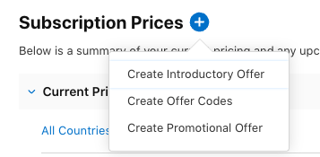

# How to Change App Store Subscription Prices, Step by Step

Changing an App Store subscription price should be a short task. In App Store Connect, it is hidden behind several similarly named screens. The label **Add Pricing** is especially misleading: its menu is for introductory offers, offer codes, and promotional offers. It is not where the normal subscription price change begins.

This is the route to use for an auto-renewable subscription, starting with the United States price in USD.

## 1. Open the individual subscription

In App Store Connect, open **Apps**, select your app, choose **Distribution**, then **Subscriptions**. Open the subscription group, then click the individual subscription product. You should be on a page with the subscription reference name, availability, and a **Subscription Prices** section.

## 2. Ignore Add Pricing for the normal price

The blue plus beside **Subscription Prices** opens this menu:

Those are useful for discounts and trials. They are not the starting point for changing the regular price a new subscriber sees.

## 3. Open All Prices and Currencies

On the right side of the **Subscription Prices** heading, click **All Prices and Currencies**. This opens Apple’s separate pricing matrix. It is the screen with the two controls you need:

1. Set **Country or Region** to **United States (USD)**.
2. Open **Price** and choose the USD price point.
3. Review the calculated prices for the other countries or regions.
4. Confirm the change only after checking the storefronts that matter to you.

Apple calculates comparable storefront prices from the USD selection. You can override individual storefronts in the review step when needed.

## 4. Check whether the subscription is already live

The flow differs slightly for a live subscription price increase. Apple’s documentation calls that route **Plan Subscription Price Change** and asks whether existing subscribers should keep their old price or move to the new one. For an increase affecting existing subscribers, Apple may notify them or require their consent before renewal.

If your individual subscription is still **Ready for Review**, you may see the pricing matrix rather than that named option. Set the starting price there. If it is already live, look for the existing-subscriber choice before confirming.

## If the matrix shows dashes

The pricing matrix can briefly show dashes even when the subscription detail page shows a current price. Refresh once, then return to the subscription page and use **View all Subscription Pricing** below the country table. Do not assume blank rows mean the subscription has no price until both views agree.

Apple’s wording and placement change, but the two durable landmarks are the individual subscription page and **All Prices and Currencies**. Apple’s own reference is [Manage pricing for auto-renewable subscriptions](https://developer.apple.com/help/app-store-connect/manage-subscriptions/manage-pricing-for-auto-renewable-subscriptions).

---

*This post is part of the [Applicaudia blog](https://applicaudia.se/blog/).*
