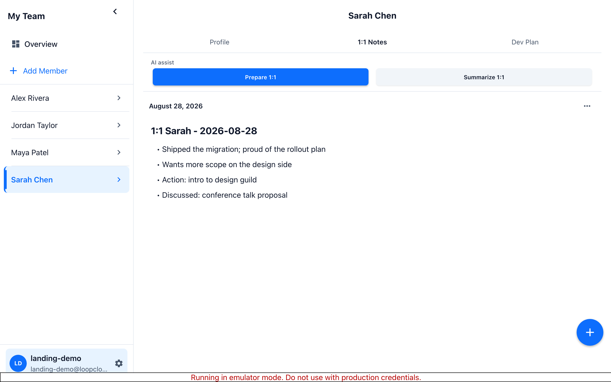
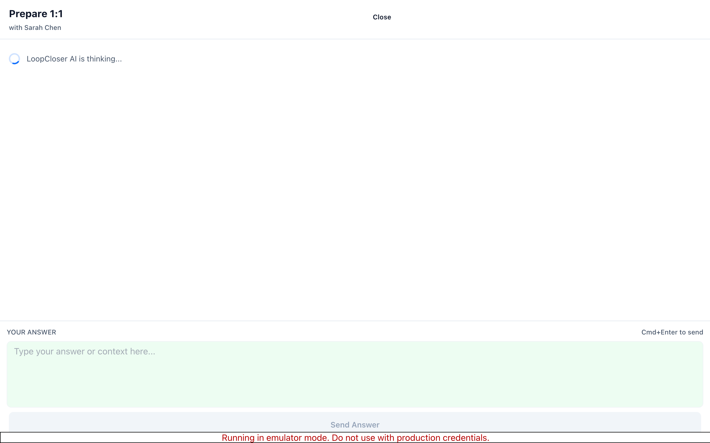

# The Tool I Always Wanted as an Engineering Manager

I am an engineering manager in Gothenburg, Sweden. I found a lot of friction in the tools I was using for 1:1s, development plans, and for performance reviews and 360 feedback. I'm also a firm believer in humble, host leadership, and extreme ownership. So I am building a tool that will help me keep track of the loops I need to close with my employees, so I can directly follow up and coach them in their development, their strengths and weaknesses, and on the actions we have towards each other. It also lets me take kudos and feedback for other employees from one 1:1 or conversation, into another one.

My goal is to reduce friction in the life of a manager - but also improve the quality that their employees experience.

Every 1:1 is preceded with an AI-guided preparation phase which can follow up on notes from previous 1:1 meetings and on the progress of the development plan. I am building the same for 360 feedback: the parts that eat a manager's calendar, like mapping reviewers to reviewees, sending the requests, and summarizing what comes back. The app will be opinionated and follow the principles of level 5 leadership.

## What LoopCloser is today

[LoopCloser](https://loopcloserapp.com) is a notebook built around 1:1 conversations. Each person you manage gets a space with their notes, their commitments, their growth plan. The design goal is simple: the next conversation starts where the last one ended, with nothing kept only in your head.

Notes can be drafted, with the help of AI, before a 1:1 and finished after it. Commitments become tracked items instead of sentences in a paragraph. There is an AI coach that reads the notes you wrote and points out things worth attention: a concern that has come up three weeks in a row, a goal that has not moved since spring, a question you might want to ask.

The app exists today as a web app, an iOS app in TestFlight, and an Android app in internal testing. It is in daily use, by which I mean mostly me, which is honest and also the point of this post.

## Launching in public, with a deadline

I have wanted to build this for years. What finally got me moving was RevenueCat's Ship-a-ton, a competition with a deadline: my app has to reach the stores by September 19, 2026. LoopCloser goes public in the App Store and Google Play before that date, or the entry does not happen.

I am going to build the rest of it in public, here on this blog. The plan, roughly:

1. **What exists today** - the app as it stands, what works, what is rough.
2. **Monetization and the paywall** - what it will cost, how the free tier is drawn, and why.
3. **Launch week** - store review, the things that break, and what actually ships.

I am also posting as it happens on the Ship-a-ton Discord, and I will read everything that comes back. If you want to try the app, go to [loopcloserapp.com](https://loopcloserapp.com), or ping me there or at support@applicaudia.se and I will hook you up with a trial code for the web app.
