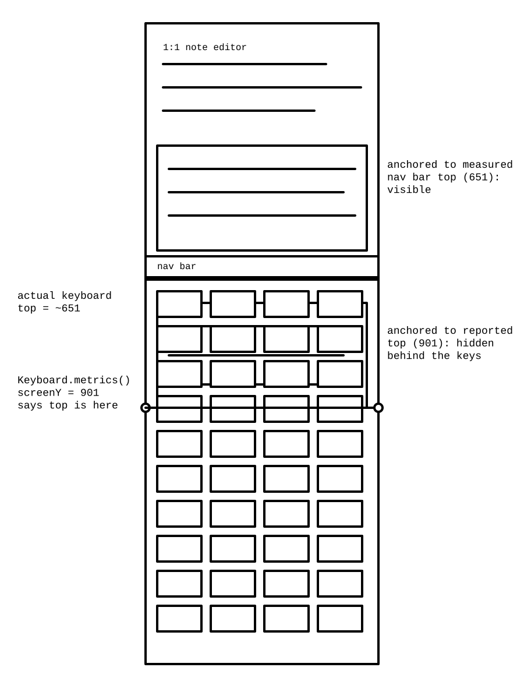

# The Bug That Only Happened on One Tablet

I take notes in my 1:1s with an app I built for myself. It is called LoopCloser, a manager's notebook for one-on-ones and performance reviews. Yesterday a colleague watched me pull up his own discussion queue mid-meeting and had no idea it was my software. He also does not know what that software put me through the week before: a bug that reproduced on exactly one device out of everything we own, and an Android keyboard that lied about its own geometry. The rule I took away: never anchor floating UI to geometry the keyboard reports. Measure views you own, and anchor to those.

## The symptom

Typing `@` in the note editor opens a team member picker. Empty query, whole team. Type `@ja` and it narrows to Janakiraman. On my Pixel, the web build, the emulator: fine. On my Onyx Boox Go 10.3, an e-ink Android tablet: the list vanished. Sometimes. Other times the same tablet rendered it fine, and an intermittent bug on a device you cannot debug interactively is where debugging joy goes to die.

Stranger still: when I dismissed the keyboard, the list was sitting there in its expected place, as if it had rendered correctly all along and something was covering it.

## The wrong theories, in order of confidence

I ran three AI agents on this alongside myself. Each produced a plausible theory. Each was wrong.

**Server-side roster race.** The first and longest-lasting theory: the picker was filtering a Firestore projection that had not finished loading, so Janakiraman was absent when the query ran. It explained "sometimes it works" but not why the empty query always showed the full roster. I advanced this one more than once. I was told, with increasing volume, that it was "VERY OBVIOUSLY NOT SERVER SIDE."

**E-ink paint latency.** The list rendered but the display had not refreshed. Died fast: screencaps come from the framebuffer, below the e-ink refresh layer entirely, and the list was not in the framebuffer.

**IME query corruption.** The Boox's custom input method was mangling the text, feeding the filter a different query than what was on screen. Plausible, wrong.

The pattern worth naming: every theory came from reading code and reasoning about what *should* happen. None came from watching the actual device. One agent even argued with my own observations of what was on screen. The low point was asking an agent whether it remembered that we had established, hours earlier, that a given fix worked. I will spare you the exact phrasing of my reply, but it involved rodents and memory.

## What the Onyx Boox keyboard actually reported

Two observations cracked it.

First, the dismissed keyboard. Dismissing it revealed the "missing" list exactly where it belonged. Rendering and filtering were fine. The keyboard's presence was the problem.

Second, the numbers. Our overlay placed the list by asking the platform where the keyboard was. On the Boox, React Native's [`Keyboard.metrics()`](https://reactnative.dev/docs/keyboard) reported the keyboard's top edge at roughly y = 901 in window coordinates. Measuring the visible chrome myself: the keyboard starts at about y = 651. The keyboard was reporting its top edge 250 pixels *below* where it actually sits. Worse, the Boox IME is a "silent" one that often never fires `keyboardDidShow` / `keyboardDidHide` at all.

So the placement code, trusting the report, pinned the list's bottom at y = 901. The list grew upward into the region the keyboard actually occupies starting at 651, and the keyboard composites over it. The list was being drawn, in full, behind the keyboard. Every single time.



## The antipattern: trusting keyboard-reported geometry

You have a floating element, an autocomplete list or a mention picker, and you want it above the soft keyboard:

```tsx
// The antipattern: anchor floating UI to keyboard-reported geometry.
const [keyboardTop, setKeyboardTop] = useState<number | null>(null);

useEffect(() => {
  const show = Keyboard.addListener('keyboardDidShow', (e) => {
    setKeyboardTop(windowHeight - e.endCoordinates.height);
  });
  const hide = Keyboard.addListener('keyboardDidHide', () => {
    setKeyboardTop(null);
  });
  return () => {
    show.remove();
    hide.remove();
  };
}, []);
```

This works on the stock devices I have tested, which is what makes it dangerous. The code is only correct if the IME is a truthful narrator. On my Boox it either stays silent or understates its height by about 250 logical pixels, so even a "successful" event places the anchor underwater. The bug is in the *trust*.

## The safe pattern: anchor to views you measured yourself

The fix removes the keyboard from the placement math entirely. The app has a bottom navigation bar. Whatever the keyboard does to the window is already baked into where that nav bar ends up. On a normal device the keyboard shrinks the window and the nav bar moves up. On the Boox, the nav bar still sits wherever the window actually put it. Ground truth, measured, not reported.

```tsx
// Measure a view you own and publish its window-space position.
const navRef = useRef<View | null>(null); // position read via measureInWindow
const [navTopY, setNavTopY] = useState<number | null>(null);

const measureNav = useCallback(() => {
  const nav = navRef.current;
  if (!nav || typeof nav.measureInWindow !== 'function') return;
  nav.measureInWindow((_x, y) => {
    setNavTopY((prev) => (prev === y ? prev : y));
  });
}, []);
```

The overlay anchors to that:

```tsx
// Anchor the list's bottom edge to the measured nav bar top,
// with a measured fallback while the nav has not reported yet.
const bottomLimit = navTopY ?? (layerHost.originY + layerHost.height);
// ...pin list bottom above bottomLimit, grow upward
```

One refinement proved necessary, and it is the part I got wrong first. On the Boox, layout does not settle the moment a component mounts; the window can still be moving while React thinks everything is measured. So: draw from the first reading, then re-measure until two readings agree.

```tsx
// Re-measure as layout settles: draw first, re-check shortly after.
useEffect(() => {
  if (navTopY === null) return undefined;
  const timers = [350, 800].map((ms) => setTimeout(measureNav, ms));
  return () => timers.forEach(clearTimeout);
}, [measureNav, navTopY]);
```

The rules I now follow:

1. Never trust keyboard-reported geometry for placement: events, metrics, estimated insets.
2. Anchor floating UI to views you own and measured in window space. Their position already includes whatever the keyboard and the window did.
3. Measure until stable, then place. Draw from the first reading if you must, but re-measure and re-place when it changes.
4. Keep a measured fallback. If the anchor view has not reported yet, fall back to another measured view, never to a constant, and never to a keyboard guess.

The result: the list sits directly above the nav bar on every device we ship to, from one code path, with no platform branching.

## Coda

Root cause: a silent IME with understated metrics, and placement code that had assumed a truthful keyboard since the day it was written. Agents involved: three. Theories that survived contact with the device: zero. The observation that cracked it came from staring at the actual screen, the one measurement channel that never lies about what the user sees.

My colleague knows none of this. As far as he knows, the app that pulled up his discussion queue in half a second is just a good app. Some weeks, that is the review that makes the rodent-themed shouting worth it.
